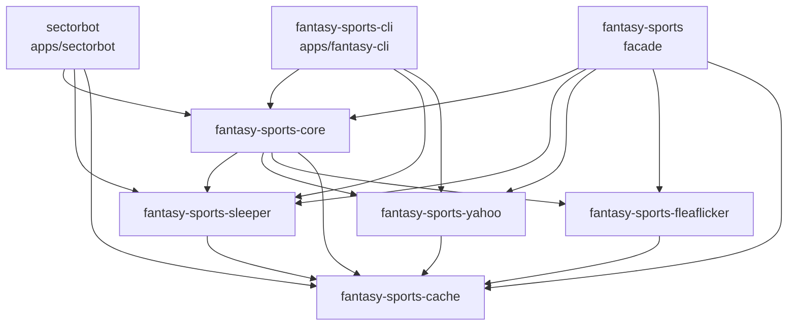

# Architecture

This document explains how the workspace is put together and why. For how to build and use it,
see the [README](../README.md).

## Goals

1. **One model, many platforms.** Callers should be able to ask for "a league" and get rosters,
   drafts, matchups, standings and transactions without caring whether the data came from Yahoo,
   Sleeper or Fleaflicker.
2. **Be a good API citizen.** These APIs are rate limited or unofficial. Everything fetched is
   cached on disk so that browsing, development and tests do not hammer them.
3. **Each layer usable on its own.** The platform clients, the cache and the data model are
   separate crates, so you can take just the Sleeper client without the rest.
4. **Testable offline.** No test needs credentials or the network.

## Crate graph



Dependencies only point downwards; the platform clients know nothing about each other or the
common model.

## Layers

### `fantasy-sports-cache`: a GET client with a disk cache

Every platform API used here is read through a `Client` that wraps `reqwest` and a `Cacheable`
store:

- A request is described by a path, optional query filters and an expected body format
  (JSON or XML). Yahoo answers in XML, the others in JSON.
- The cache key is the full URL. Responses are written to a file named by the SHA-256 of the
  key, with a metadata file recording when each entry was stored and its time to live
  (24 hours by default). A cache hit deserializes the stored bytes and never touches the
  network; `force_update` skips the lookup.
- Only successful (200) responses are cached. A 404 becomes `Error::NotFound`; any other status
  becomes `Error::ClientError { status, body }`, keeping the body because some APIs explain
  the failure there (Yahoo reports `token_expired` that way).
- A request can carry a bearer token. It is deliberately not part of the cache key.
- The client counts outgoing requests, which the tests use to prove a call was served from
  the cache.

### Platform clients

| Crate | API | Notes |
|---|---|---|
| `fantasy-sports-sleeper` | JSON over REST, no auth | Users, leagues, rosters, drafts and picks, matchups, transactions, playoff brackets, players; plus the unofficial projections and stats endpoints (`unofficial` module) |
| `fantasy-sports-yahoo` | XML, OAuth2 | Strongly typed league/team/roster/transaction/scoreboard resources and `LeagueKey`/`TeamKey`-style keys |
| `fantasy-sports-fleaflicker` | JSON, no auth | Leagues, rosters, standings, drafts, activity, box scores |

Each client is a thin, typed mapping of its API. They keep the platform's vocabulary; mapping
to the common model happens one layer up.

**Yahoo authentication.** Yahoo's flow is OAuth2 authorization code with PKCE. The client is a
public one, so there is no client secret: it builds the authorization URL with a code challenge,
exchanges the code (plus the verifier) for a token, and stores the token as a JSON file.
`refresh_token(force)` refreshes only when the token is expired. A token that expires in the
middle of a run surfaces as `Error::TokenExpired` rather than being retried transparently.

### `fantasy-sports-core`: the common model

`LeagueAccessor` is the entry point. It owns an optional client per platform plus a player
cache, and `fetch_league_context(&ExternalId, force_update)` dispatches on the platform:

```text
ExternalId "sleeper:123"  ─┐
ExternalId "yahoo:359.l.5" ─┼─► LeagueAccessor ──► platform client ──► cache ──► API
ExternalId "fleaflicker:9" ─┘          │
                                       └─► League  (enum: Sleeper | Yahoo | FleaFlicker)
```

`ExternalId` is the `"<platform>:<id>"` string used everywhere to name a league, user or
transaction without losing which platform it belongs to.

`League` keeps the platform's own data in a variant, and exposes the common views as methods:
name, season, standings, draft (picks), transactions, matchup scoreboards, rosters. The
conversions normalize quirks such as Yahoo's playoff weeks and Sleeper's roster ids.

The **player cache** (a `sled` database) stores Sleeper's player universe and a mapping from
Yahoo player ids to Sleeper ids, so a Yahoo roster can be shown with the same player data as a
Sleeper one.

`history::build_owner_records` merges one person's records across seasons and platforms,
given a list of the ids they have used.

### `fantasy-sports`: the facade

Re-exports the core model at the top level and each platform client as a module, so an
application can depend on one crate.

## Applications

### `fantasy-cli`

A terminal UI built on `ratatui` and `crossterm`.

- `tui.rs` runs the event loop. A background task owns the `LeagueAccessor` and performs fetches
  on request (`BackendAction`), sending results back over a channel (`Event`) so the UI never
  blocks on the network.
- `pages/` are full screens (league list, summary, matchups, draft board, transactions, league
  history); `widgets/` are reusable pieces (roster, draft picks, matchups list, settings).
- Configuration is `config.json` in the OS config directory; see `config.example.json`. It
  holds the landing page, the Sleeper user, and the owner alias table used by the history page.
  Responses are cached under the OS cache directory.

### `sectorbot`

A Discord bot with a small HTTP API, built on `serenity` and `axum`.

```text
   Twitter / YouTube ──► feed fetcher ──► channel ──► Discord handler ──► Discord channel
        (opt-in)          (per feed)                       ▲
                                                           │ !commands
   Sleeper ◄── ecr::Service (keeper costs, draft order) ◄──┘
                                       │
   sled data_store/ ◄── feeds, quotas, leagues ──► axum: /health /feeds /feeds/{name} /leagues
```

- **`config.rs`**: everything comes from environment variables (and an optional `.env`); see
  `.env.example`. Secrets never live in source or in the Docker image.
- **`store.rs`**: three `sled` trees (`feeds`, `quotas`, `leagues`). A *feed* is a named list of
  sources (Twitter accounts and YouTube channels), a Discord destination, a polling interval and
  a quiet-hours window. Feeds can be seeded from a JSON file at startup.
- **Feed fetcher** (`main.rs`, opt-in): one task per feed, staggered, polling its sources and
  sending new entries to the Discord handler. Twitter goes through the unofficial syndication
  endpoint; YouTube through the Data API, with a credit counter because the API has a daily
  quota.
- **`bot.rs`**: the Discord handler. Commands: `!ping`, `!info`, `!health`, `!keepables`,
  `!draftorder`, `!set-manager`, `!set-league`. Only the configured admin user may run them.
- **`ecr/`**: the league-specific logic. `keepers.rs` computes keeper costs from draft history:
  a player drafted last year costs the round they were drafted in; a kept player keeps their
  keeper round; after three consecutive keeps the cost resets to the player's current average
  draft position (from FantasyPros consensus rankings). `service.rs` gathers the data and
  produces the report.
- **`server.rs`**: `GET /health`, `GET /feeds`, `GET /feeds/{name}` (RSS, looked up by a slug of
  the feed name or its id) and `GET /leagues`.

## Testing

- **Unit tests** cover pure logic: keeper costs, owner-record merging, draft order bucketing,
  config parsing, bracket reading, token expiry.
- **Client tests** run the real client against a `wiremock` server replaying fixtures: happy
  paths, error mapping (a Yahoo 401 body becoming `TokenExpired`), cache behaviour, and that
  the `Authorization` header is actually sent.
- **Fixtures** live in each crate's `testdata/` or `tests/data/`. They are recorded API
  responses that have been pseudonymized (names, avatars and ids replaced consistently, so that
  cross references still resolve) or, for sectorbot, entirely synthetic and generated by
  `apps/sectorbot/testdata/gen_fixtures.py`.
- **Live tests** are `#[ignore]`d and read credentials from the environment.

## Design notes and known limitations

- **Cache invalidation is time based.** There is no conditional request (`ETag`) support, and
  data that changes quickly (live scores) needs `force_update`.
- **`sled` is unmaintained** and brings two unmaintained transitive crates. It is used in two
  places and is isolated enough to swap.
- **Losers brackets.** `Bracket::championship_match` models the losers bracket as a toilet bowl
  (the loser of the final is the champion) and ignores Sleeper's own placement (`p`) field.
  Nothing consumes the result today; if that changes, revisit it.
- **serenity 0.12 pins rustls 0.22.** The related advisories are accepted until serenity moves
  to a newer websocket stack.
- **Unofficial endpoints** (Sleeper projections, Twitter syndication) are undocumented and may
  change or disappear.
